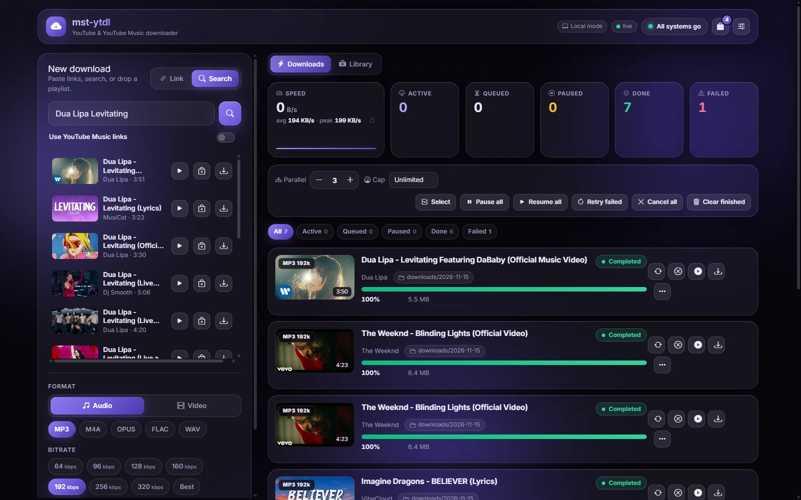
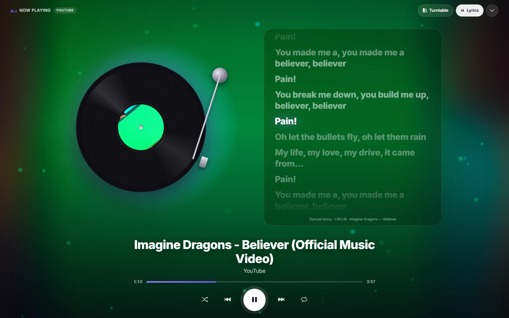
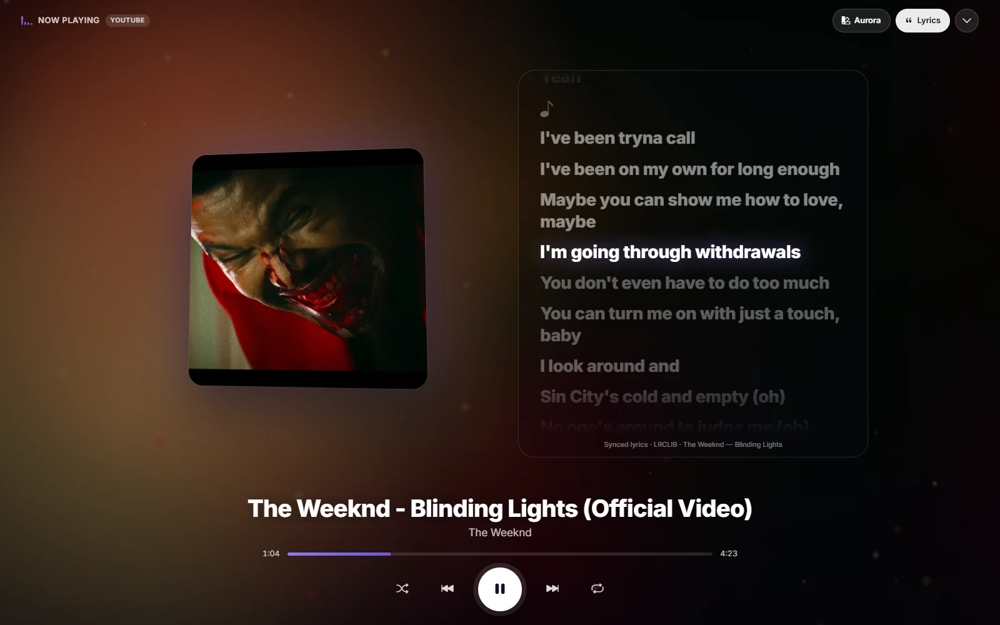
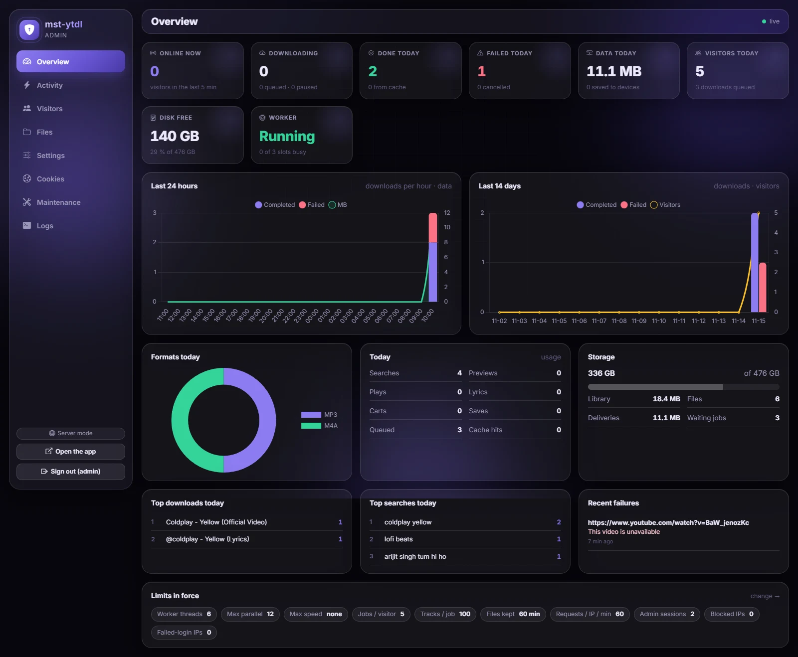
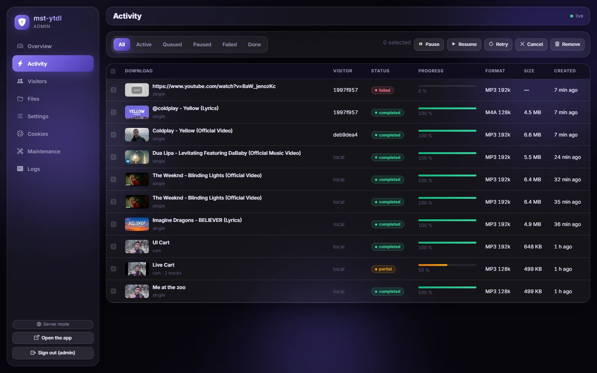
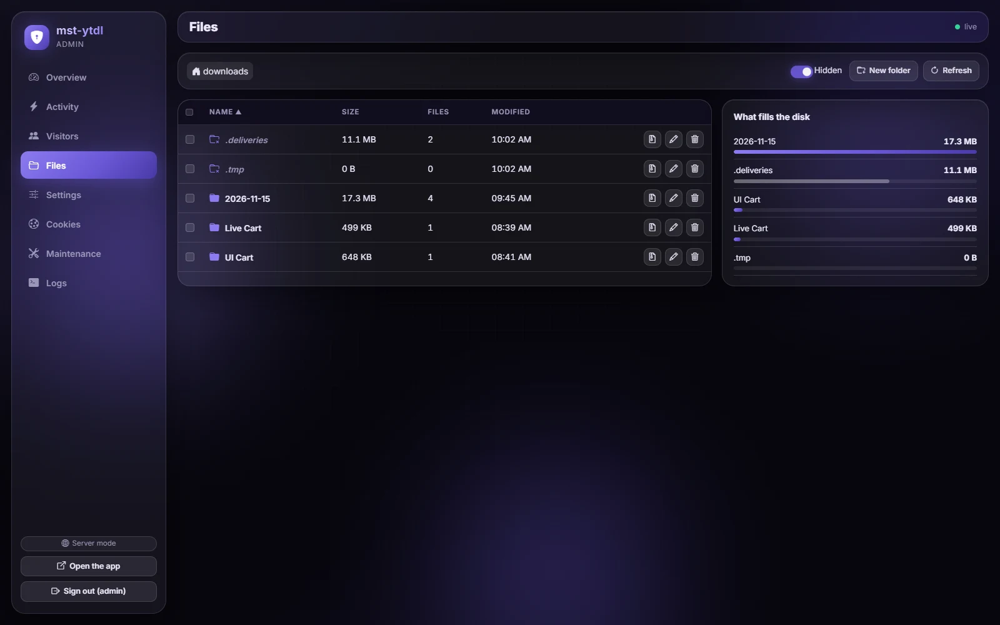
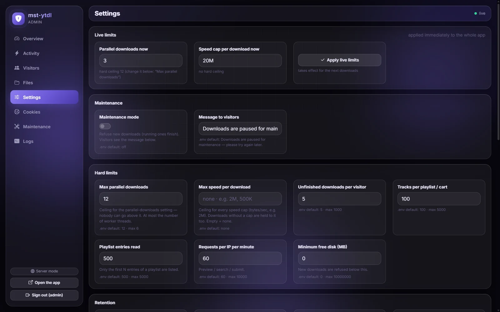
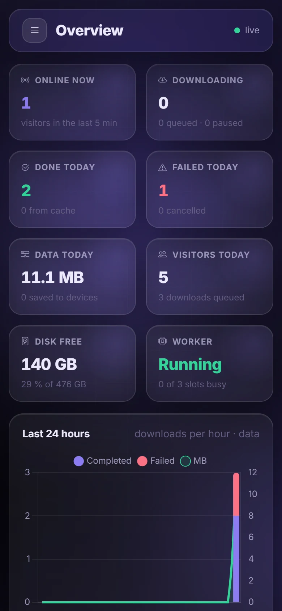
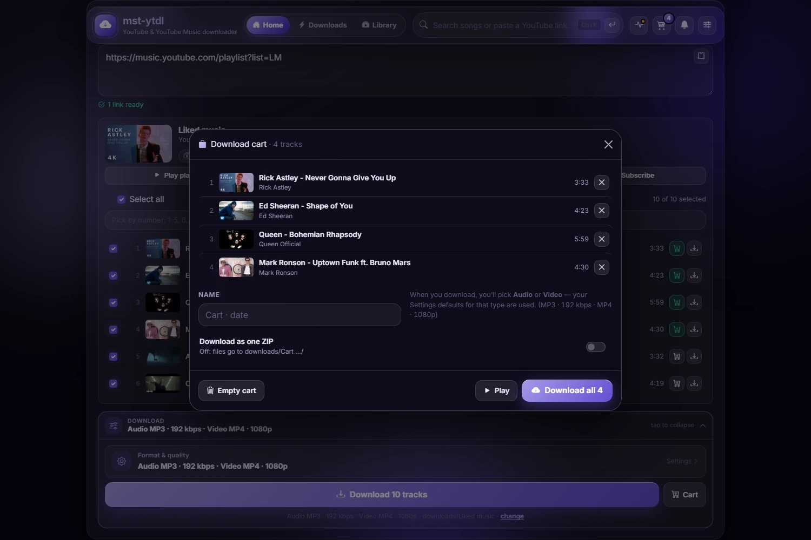
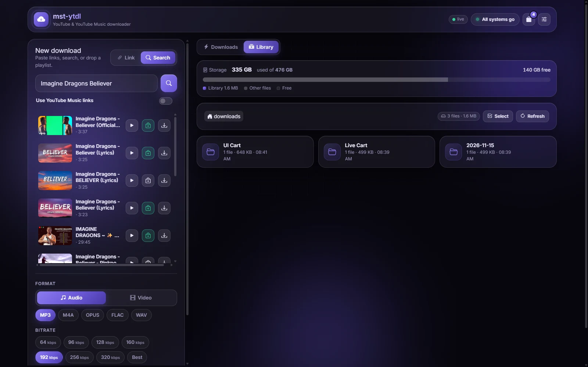

# mst-ytdl

A self-hosted **YouTube & YouTube Music downloader**: FastAPI + Huey (Redis) + yt-dlp, with a dark, glass-morphism web UI.

Paste a video, a song, an album or a whole playlist → pick MP3 / MP4 (and more) and a quality → watch it download live, with **pause / resume / cancel / retry**, parallel workers and per-item status.



```
downloads/
├── 2026-11-14/                  ← single videos: folder named after today's date
│   ├── Me at the zoo.mp3
│   └── Me at the zoo.mp4
└── My Road Trip Mix/            ← playlists: folder named after the playlist
    ├── 01 - First song.mp3
    └── 02 - Second song.mp3
```

## Features

| Area | What you get |
|---|---|
| Sources | YouTube + YouTube Music: videos, shorts, `youtu.be`, playlists, albums, channels, Mix/radio lists; **text search**; many links at once |
| Formats | Audio **MP3** (64–320 kbps), M4A, Opus, FLAC, WAV · Video **MP4** (144p–4K), MKV, WebM |
| Quality | Bitrate / resolution chooser; the UI greys out sizes a video doesn't offer |
| Control | **Start, pause, resume, cancel, retry** per track, per job, or for the whole queue. Pause keeps the `.part` file, so resume continues from the same byte |
| Parallelism | Huey consumer threads = hard ceiling; a **live "parallel downloads" limit** (UI stepper) enforced across processes by a Redis slot limiter, plus yt-dlp's parallel fragment download inside each file |
| Status | Per-job and per-track progress, speed, ETA, bytes, stage ("merging", "converting audio"…), live over **SSE** with a sparkline of total speed |
| Extras | Cover art + tags embedded, subtitles (download + embed), speed cap, skip files that already exist (or *overwrite*), playlist track picker (`1-5, 8, 12-`), custom folder name, ZIP download of a playlist, built-in player + library browser |
| Resilience | Auto-retry for transient errors (not for private/removed videos), crash recovery (dead workers' downloads become *Paused*), health pill (Redis / worker / ffmpeg) |
| Cart | **Download cart**: collect songs from search results, playlist previews and pasted links, then download them in one go (one folder, or one ZIP) |
| Admin dashboard | **`/admin`** (username + password): live analytics, every visitor's downloads, visitors & IP blocks, full file manager (hidden folders too), live settings and hard limits, maintenance mode, cache controls, log viewer |
| Server mode | `SERVER_MODE=true` turns it into a public site: private per-visitor queues, finished files handed to the browser and **deleted after an hour**, admin-locked library management, limits — see below |
| Safety | Host allow-list (YouTube only), path-traversal-proof library API, loopback bind by default |

## In-app player (play anything, no downloading needed)

A docked player plus a **floating video window** (drag by the header, resize from any corner, snap to edges, S/M/L presets, fullscreen, picture-in-picture; position is remembered; docks above the player on phones).

- **Plays every YouTube video yt-dlp can read** — streams are relayed by *our* server (`/api/stream/<id>/…`, Range-capable), not YouTube's iframe, so "owner disabled embedding" never blocks you. Above YouTube's muxed 720p the picture and sound are separate streams, played as two clock-synced elements.
- **Quality** (Auto / 1080p / 720p / … / Audio only), **subtitles** (manual + auto captions, size S/M/L; also for downloaded videos: embedded tracks via ffmpeg + `.srt/.vtt` sidecars), **speed** 0.5–2×, volume, seek with buffered range + hover time, repeat (off/all/one), **true shuffle** (every track once per cycle), reorderable queue (drag), *shuffle rest*, **sleep timer** (15–60 min or end of track, fades out), media-keys/OS controls.
- Play/Shuffle buttons on: search results, playlist previews (before downloading), finished playlist jobs, library folders and selections.
- Keys: `V` player mode · `Y` lyrics · `Space/K` play · `←/→` ±5 s · `J/L` ±10 s · `↑/↓` volume · `M` mute · `F` fullscreen · `C` cycle captions · `T` video window · `N/P` next/prev · `S` shuffle · `R` repeat · `Q` queue · `< >` speed · `0–9` jump to %.

## Player mode & lyrics

<table>
  <tr>
    <td></td>
    <td></td>
  </tr>
  <tr>
    <td align="center"><sub>Turntable · synced lyrics</sub></td>
    <td align="center"><sub>Aurora · synced lyrics</sub></td>
  </tr>
  <tr>
    <td colspan="2"></td>
  </tr>
  <tr><td colspan="2" align="center"><sub>Orbit · the ring is the live audio spectrum</sub></td></tr>
</table>

While something plays, **✦** in the player (or `V`) opens a full-screen player over the blurred, slowly drifting cover art, with an animated scene that reacts to the music (Web Audio analyser): **Turntable** (spinning record with the cover as label, tonearm swings on), **Aurora** (drifting light in the cover's colours), **Orbit** (spectrum ring around the cover), or **Random each track**. The **“** button (or `Y`) shows lyrics: time-synced lines highlight as they are sung (click a line to jump there), else plain text. Lyrics come from [LRCLIB](https://lrclib.net) (free, no key) through our server (`GET /api/lyrics`, cached in Redis); only the cleaned artist / title / duration are sent. `Esc` closes. Honours *reduce motion*.

## Admin dashboard (`/admin`)

A separate, responsive page for whoever runs the server (works in both modes). Sign in with `SERVER_ADMIN_USERNAME` + the password behind `SERVER_ADMIN_PASSWORD_HASH`.



| Section | What you can do |
|---|---|
| **Overview** | KPIs (online now, downloading, done / failed today, data, visitors, disk, worker), downloads per hour (24 h) and per day (14 d), formats, today's usage (searches, previews, plays, lyrics, carts, saves, cache hits), storage split, top downloads and searches, recent failures, limits in force — refreshes every 5 s |
| **Activity** | every visitor's downloads (live), filter by status, multi-select pause / resume / retry / cancel / remove |
| **Visitors** | who is online, address, browser, requests, first / last seen; block an IP (every request from it gets 403) and unblock |
| **Files** | full file manager over `downloads/` including hidden folders: browse, sort, new folder, rename, move, copy, delete (batch), ZIP, download, preview audio / video / images / text, what fills the disk |
| **Settings** | live limits (parallel, speed cap) and every live knob: hard ceilings (max parallel ≤ worker threads, max speed), per-visitor caps, rate limit, retention times, cookie sharing, download defaults, retries, lyrics provider — validated, applied to API and worker within seconds, *reset* back to `.env` |
| **Cookies** | the server's YouTube cookies (paste / test / remove) |
| **Maintenance** | maintenance mode + message (refuses new downloads), clear lookup / media / lyrics / player / cover caches, run cleanup, expire all deliveries, recover stuck downloads, clear finished jobs, delete visitor cookies, reset statistics |
| **Logs** | live tail of every log file with level and text filters |

<table><tr>
<td></td>
<td></td>
</tr><tr>
<td></td>
<td align="center"></td>
</tr></table>

Statistics are Redis counters kept `SERVER_ANALYTICS_DAYS` (30); visitors (anonymous id, IP, browser) are tracked in server mode only and expire after 7 days.

## Sign in with Google (browser extension)

Nobody has to export a cookies file. In the cookies dialog, **Sign in with Google** opens Google's sign-in in a new tab and shows a one-time code. A small extension (`extension/`, Chrome / Edge / Brave / Firefox) sends that browser's YouTube cookies to your server when the person presses *Connect* and types the code. No Google Cloud project, OAuth client or secret is involved: a web page cannot read another site's cookies, so the extension does the one step the page can't.

- **Phones and tablets** can't run the extension. There the dialog skips the Google tab and tells the person to enter the code on a computer that is signed in to YouTube: the code belongs to the browser that asked for it, so that computer's extension links the phone (using the computer's YouTube account).
- The site serves the extension at `/api/connect/extension.zip`, already pointed at this server. It is installed once (unzip, *Load unpacked*).
- The code is single use, lasts 10 minutes and is bound to the visitor that asked for it; uploads are rate-limited per IP.
- Cookies are stored exactly like pasted ones (server mode: that visitor only, deleted after `SERVER_VISITOR_COOKIE_HOURS`). Logged-out cookies are refused and never overwrite working ones.
- `SERVER_CONNECT_ENABLED` / admin → Settings → *Sign in with the browser extension* turns it off; pasting cookies keeps working either way.

## My YouTube (playlists and home feed)

The **Mine** tab of *New download* reads the signed-in account through your YouTube cookies: *Liked music*, *Liked videos*, *Watch later*, your library playlists, and the home feed YouTube recommends to you. A playlist opens in the normal link flow (pick tracks, play, shuffle, add to cart, download; every track row also has its own play / cart / download buttons); feed rows have the same play / cart / download buttons plus play all, shuffle and download all.

- **Local mode** uses the server's cookies (yours). **Server mode** uses only the visitor's *own* cookies, never the server's, even with `SERVER_SHARE_SERVER_COOKIES`, and caches per visitor.
- YouTube Music's own home page is not available to yt-dlp; *Liked music* (opens with YouTube Music links) and the YouTube home feed stand in for it.
- Without login cookies the tab explains this and opens the cookies dialog. Expired cookies show a message instead of an error.

## Download cart

The bag button in the header opens the cart. Add with the *bag +* buttons on search results (one, or *All to cart*), on a URL preview (*Add to cart* / *Selected to cart* for a playlist), or with **Cart** next to *Download* (every pasted link; playlists add their available tracks). The cart lives in your browser (synced across tabs).



*Download all* creates **one job** with the format and options picked in *New download*: the files land in `downloads/<cart name>/` (`01 - Title.mp3` …). Turn on *Download as one ZIP* and the browser saves a ZIP of exactly those files when the job finishes. In server mode the cart is always handed over as a ZIP.

## Server mode (`SERVER_MODE=true`)

For running the app on a server for other people. Off by default; with `SERVER_MODE=false` nothing below applies.

| | Personal mode (default) | Server mode |
|---|---|---|
| Queue | one shared queue | **private per browser** (anonymous HttpOnly cookie); other visitors' jobs are 404 |
| Where files go | `downloads/<date or playlist>/` | `downloads/.deliveries/<job id>/` — one private directory per job, hidden from the library |
| When a job finishes | stays in the library | single video → the file, playlist / cart → **one ZIP** (stored, no recompression); the browser saves it automatically (and a *Save* button stays) |
| Cleanup | never | a Huey task every minute deletes jobs whose delivery is older than `SERVER_DELIVERY_TTL_MINUTES` (60): records, the job directory, temp dirs. Paused jobs idle that long and unreferenced directories go too |
| Library | full control | **read-only** in the app (browse, play, save, ZIP); the admin manages files at `/admin` |
| Settings | open | the app shows only the visitor's own cookies; limits, server cookies and everything else live at `/admin`; per-download folder / overwrite are ignored |
| Limits | – | hard ceilings for parallel downloads (`TASK_MAX_PARALLEL_CAP`) and speed (`SERVER_MAX_SPEED`) that nothing can exceed (422), `SERVER_MAX_ACTIVE_JOBS` per visitor, `SERVER_MAX_JOB_ITEMS` per playlist / cart, `SERVER_MIN_FREE_MB` disk guard (503), `SERVER_RATE_LIMIT_PER_MINUTE` per IP on preview / search / submit (429) |
| Caching | – | previews, searches and playlist reads cached `SERVER_CACHE_MINUTES`; a finished file is reused (hard link) when another visitor asks for the same video + format + options within the TTL |

**YouTube cookies per visitor.** Your own cookies file is never used for visitors (unless `SERVER_SHARE_SERVER_COOKIES=true`). Anyone can paste *their* cookies in Settings → *Your YouTube cookies*: they are validated, kept in Redis for `SERVER_VISITOR_COOKIE_HOURS` (24) or until removed, and used only for that browser's previews, searches, downloads and playback (a private temp file per yt-dlp call, deleted afterwards; cookies YouTube rotates are written back). Caches filled with someone's cookies are kept per visitor; anonymous lookups stay shared.

Deletion is index-driven: every finished job gets a record (`P:DELIVERY:<job>`, plus a sorted set by expiry) and the sweep only ever deletes `downloads/.deliveries/<job id>/` of expired records, so two visitors downloading the same song never touch each other's files.

**Admin password.** Hash it, put the line in `.env` (username: `SERVER_ADMIN_USERNAME`, default `admin`), restart:

```bash
uv run python main.py hash-password
```

Then sign in at **`/admin`** (session 12 h, `SERVER_ADMIN_SESSION_HOURS`; 8 wrong attempts lock that IP out for 15 minutes). Without a hash the dashboard is open in personal mode and locked in server mode. The main app never shows admin controls in server mode.

Running it publicly: bind `API_HOST=0.0.0.0` (compose already does) behind HTTPS (a reverse proxy; uvicorn runs with `--proxy-headers`, so rate limits see the real client IP).

## Logs

Everything is written under one directory, **`./logs/`** (gitignored; in Docker `./logs` is mounted into `app` and `huey`):

| File | Contents |
|---|---|
| `api.log` | API process: app code, uvicorn |
| `worker.log` | Huey worker: downloads, progress lines, retries, huey itself |
| `api.errors.log`, `worker.errors.log` | `WARNING` and above only |
| `access.log` | One line per HTTP request |

Each file rotates at 5 MB (5 backups). `LOG_ROLE` (`api` / `worker`, set by `main.py` and compose) names a process' files; plain `uvicorn …` without it writes `app.log`. Passwords, tokens and cookies are masked. The console output is unchanged (`docker compose logs -f huey`).

## Smaller things worth knowing

- **Worker log lines** (`docker compose logs -f huey`): `[a1b2c3] Believer  40%  3.1 MiB/s  eta 0:12`, plus start / converting / completed (size + time) / failed. Plain lines, not tqdm: progress bars need a TTY and several parallel downloads would garble each other.
- **Speed tile**: shows the live speed plus **average** (only while downloading) and **peak** for this browser session (↺ resets).
- **Default download folder**: Settings → *Default download folder* (Browse lists existing folders or type a new one). Singles go straight into it, playlists into `<folder>/<Playlist name>`; a folder typed in the composer still wins. A browser cannot open a native file explorer for a server path; move the whole root with `DL_DOWNLOADS_DIR` (Docker: the compose volume).
- **Filename numbering**: Options → *Number playlist tracks*. Off = `Title.mp3` instead of `01 - Title.mp3`. The server default is `DL_PLAYLIST_NUMBERING`.
- **Album art in the player**: covers embedded in your files (and `Title.jpg` next to them) are served by `GET /api/library/cover` and shown in the dock, queue and library list.
- **Storage bar** (Library tab): disk used / total / free, with the library's share highlighted; turns amber at 80 % and red at 92 %.

  

## Download management

Failed / paused / cancelled / finished downloads each have their own filter and a contextual bar (*Retry all · Restart all · Remove all* …). Per item: **Retry** (continue from the partial file), **Restart / replace** (fresh download that overwrites the old file only once it succeeds), **Remove**. **Select** mode gives a multi-select bar (pause, resume, retry, restart, cancel, remove, remove + files). Library: multi-select → play, queue, ZIP, **move to folder**, delete; rename files/folders. Custom destination folder per download (nested like `Music/Rock`, suggestions from existing folders).

## Quick start

> **Windows:** run `uv` from PowerShell / Git Bash, not WSL — `.venv` is a Windows venv and WSL's `uv` tries to replace it with a Linux one (deleting packages while the app runs). Docker still goes through WSL.

Requirements: [uv](https://docs.astral.sh/uv/), Docker (for Redis), Node.js (yt-dlp uses a JS runtime to solve YouTube's challenges; Deno/Bun also work). ffmpeg ships with the project (`imageio-ffmpeg`) unless you have your own.

```bash
uv sync
cp .env.sample .env                 # adjust if you like (see the table below)
docker compose up -d redis          # Redis on localhost:6379

uv run python main.py dev           # worker + API (reload) together
# …or in two terminals:
uv run python main.py worker        # Huey consumer — does the downloading
uv run python main.py api           # FastAPI + UI on http://127.0.0.1:8000
```

Open <http://127.0.0.1:8000>. API docs: <http://127.0.0.1:8000/docs>.

> **Windows + WSL Docker:** run compose through WSL, e.g. `wsl -e sh -c "cd /mnt/d/0Coding/mst-ytdl && docker compose up -d redis"`. Redis is reachable from Windows on `localhost:6379`.

Everything in containers: `docker compose up -d --build` once (Redis + worker + API, downloads mounted at `./downloads`); `docker compose down` stops it all. The source code is mounted into the containers, so after editing code just `docker compose restart app huey`; after editing `.env`, `docker compose up -d`; rebuild (`--build`) only when dependencies or the Dockerfile change. For local dev with `uv run`, start only Redis: `docker compose up -d redis`.

## Cookies (fixes "Sign in to confirm you're not a bot")

YouTube sometimes blocks an IP that makes many requests; every lookup (downloads **and** the player) then fails with that message. Give yt-dlp your logged-in browser's cookies:

| Setting | Works where | How |
|---|---|---|
| `DL_COOKIES_FROM_BROWSER=chrome` (or `firefox`, `edge`) | Only when the app runs **on your machine** (`uv run`), **not in Docker** (the container cannot see your browser profile) | Set it in `.env`, restart |
| `DL_COOKIES_FILE=<path to an exported cookies.txt>` | Everywhere, **including Docker** if the file is mounted into the container | see below |

**Easiest — in the web UI:** Settings → *YouTube cookies* → **Edit**, paste the Netscape `cookies.txt`, **Save cookies**. The server validates the format, keeps only youtube.com / google.com cookies, stores them (owner-only) in `cookies/cookies.txt` and immediately runs a **live test** against YouTube (shows ✓/✗ with the reason). Settings shows whether cookies are loaded, whether they are a signed-in session, and when the login expires (warns when logged-out, expired or expiring within a week). Cookie values are never sent back to the browser. *Test* re-checks any time; *Remove cookies* deletes the file. No restart needed.

**Docker (manual file):** 1) In a browser where you are logged in to YouTube, install a "cookies.txt" exporter extension (e.g. *Get cookies.txt LOCALLY*), open youtube.com and export in **Netscape format**. 2) Save it as `./cookies/cookies.txt` (compose mounts `./cookies` at `/app/cookies`; the folder is gitignored). 3) In `.env` set `DL_COOKIES_FILE=/app/cookies/cookies.txt`. 4) `docker compose up -d --build`. Tip: use a throw-away Google account — heavy automated use can get an account flagged — and re-export when cookies expire. Never commit or share the file.

## Architecture

```
 browser ──HTTP/SSE──▶ api/ (FastAPI)  ──▶ services/ ──▶ Redis  (job/item hashes, slots, runtime settings)
                           │                  ▲  │
                           └── enqueue ──▶ tasks/ (Huey) ──▶ services/downloader ──▶ yt-dlp + ffmpeg ──▶ downloads/
```

- **api/** – thin routers; services raise `NotFoundError`/`ConflictError`/`InvalidRequestError`, mapped to 404/409/422.
- **tasks/** – three thin Huey tasks (`resolve_job`, `download_item`, periodic `reconcile`). Services never import tasks: `tasks` registers a dispatcher in `services.dispatch`.
- **services/** – all logic: `manager` (orchestration), `downloader` (runs one item), `store` (Redis persistence, atomic transitions), `runtime` (live settings + slot limiter), `metadata` (URL → preview/playlist/search), `ytdl_opts` (options → yt-dlp), `library` (files).
- **models/** – pydantic requests, records and views. **configs/** – settings + client singletons. **modules/** – generic helpers.

How pause/cancel work: the API writes `control=pause|cancel` on the item's Redis hash; the running worker's progress hook (≈2×/s) sees it and raises `DownloadInterrupted` (a subclass of yt-dlp's own `DownloadCancelled`). Pause keeps the partial file; cancel deletes it. Queued items are changed immediately and their pending task goes stale via a per-run token.

## Configuration (`.env`)

Loaded by `configs/config.py` (real env vars win over `.env`, which wins over defaults). See `.env.sample` for comments.

| Variable | Default | Meaning |
|---|---|---|
| `REDIS_URL` | `redis://localhost:6379/0` | Broker + state store |
| `REDIS_KEY_PREFIX` | `YTDL` | Prefix for every key written |
| `API_HOST` / `API_PORT` | `127.0.0.1` / `8000` | Bind address (the app fetches URLs for the caller — don't expose it unauthenticated) |
| `API_DEBUG`, `API_CORS_ORIGINS` | `false`, `["*"]` | |
| `DL_DOWNLOADS_DIR` | `downloads` | Relative to the repo root |
| `DL_TIMEZONE`, `DL_DATE_FOLDER_FORMAT` | `Asia/Kolkata`, `%Y-%m-%d` | Name of the per-day folder for single videos |
| `DL_PLAYLIST_NUMBERING` | `true` | Default for the “Number playlist tracks” switch (`01 - Title.mp3` in playlist / cart folders); off = plain `Title` |
| `DL_INCLUDE_ID_IN_NAME` | `false` | Append `[video_id]` to names |
| `DL_MAX_PLAYLIST_ITEMS` | `500` | Cap when expanding playlists |
| `DL_DEFAULT_FORMAT`, `DL_DEFAULT_AUDIO_QUALITY`, `DL_DEFAULT_VIDEO_QUALITY` | `mp3`, `192`, `1080` | UI/API defaults |
| `DL_CONCURRENT_FRAGMENTS` | `4` | Parallel segments inside one download |
| `DL_NETWORK_RETRIES` | `5` | yt-dlp's own retries |
| `DL_SPEED_LIMIT` | – | e.g. `2M` per download |
| `DL_EMBED_METADATA`, `DL_EMBED_THUMBNAIL` | `true` | Tags / cover art defaults |
| `DL_FFMPEG_PATH` | – | Empty = PATH, then bundled binary |
| `DL_JS_RUNTIME` | `auto` | `auto` \| `deno` \| `node` \| `bun` \| `quickjs` |
| `DL_COOKIES_FILE`, `DL_COOKIES_FROM_BROWSER`, `DL_PROXY` | – | Age-gated / member content, proxies |
| `DL_ALLOWED_HOSTS` | YouTube hosts | URL allow-list |
| `TASK_WORKERS` | `6` | Consumer threads (hard parallel ceiling) |
| `TASK_LOG_PROGRESS` | `milestones` | Worker-log progress lines (`docker logs`): `off` · `milestones` (every 10 % / 10 s) · `verbose` (5 % / 5 s) |
| `DL_DEFAULT_FOLDER` | – | Base folder inside `downloads/` for new downloads (also settable live in Settings) |
| `TASK_MAX_PARALLEL` / `TASK_MAX_PARALLEL_CAP` | `3` / `12` | Live parallel limit default / its maximum |
| `TASK_RETRY_COUNT` / `TASK_RETRY_DELAY` | `1` / `10` | Auto-retries for transient failures |
| `TASK_RECORD_RETENTION_DAYS` | `30` | Redis records expire this long after their last change |
| `TASK_IMMEDIATE` | `false` | Run tasks inline (tests only) |
| `SERVER_MODE` | `false` | Public multi-user mode (see *Server mode*) |
| `SERVER_ADMIN_PASSWORD_HASH` | – | `scrypt:…` from `main.py hash-password`; empty = management locked |
| `SERVER_ADMIN_SESSION_HOURS` | `12` | Admin login lifetime |
| `SERVER_DELIVERY_TTL_MINUTES` | `60` | How long a prepared file / ZIP stays on the server |
| `SERVER_MAX_ACTIVE_JOBS` / `SERVER_MAX_JOB_ITEMS` | `5` / `100` | Unfinished downloads per visitor / tracks per playlist or cart |
| `SERVER_MIN_FREE_MB` | `2048` | Refuse new downloads below this free disk space |
| `SERVER_RATE_LIMIT_PER_MINUTE` | `60` | Preview / search / submit calls per IP |
| `SERVER_CACHE_MINUTES` | `10` | Preview / search / playlist cache (0 = off) |
| `SERVER_VISITOR_COOKIE_HOURS` | `24` | How long a visitor's own pasted cookies are kept |
| `SERVER_MAX_SPEED` | – | Hard speed ceiling per download, e.g. `5M`: speed caps above it are rejected, uncapped downloads are held to it |
| `SERVER_ADMIN_USERNAME` | `admin` | Username for `/admin` |
| `SERVER_MAINTENANCE` / `SERVER_MAINTENANCE_MESSAGE` | `false` / … | Refuse new downloads with that message (also a switch in `/admin`) |
| `SERVER_ANALYTICS_DAYS` | `30` | How long dashboard statistics are kept |
| `SERVER_SHARE_SERVER_COOKIES` | `false` | Let visitors without own cookies use the server's cookies file |
| `DL_LYRICS_URL` | `https://lrclib.net` | Lyrics provider for the player; empty = off |
| `LOG_LEVEL`, `LOG_FORMAT` | `INFO`, `text` | `text` or `json` |
| `LOG_DIR`, `LOG_TO_FILE` | `./logs`, `true` | Where the log files go; set `LOG_TO_FILE=false` for console only |

## HTTP API (prefix `/api`)

| Method & path | Purpose |
|---|---|
| `POST /downloads` | Queue URLs `{urls[], format?, quality?, playlist_mode?, playlist_items?, embed_metadata?, embed_thumbnail?, subtitles?, subtitle_langs?, speed_limit?, overwrite?, folder?}` → `{jobs[], rejected[]}` |
| `GET /downloads` · `GET /downloads/{id}` | List (`status`, `limit`, `offset`, `include_items`) / one job with items |
| `POST /downloads/{id}/{pause\|resume\|cancel\|retry}` · `DELETE /downloads/{id}?delete_files=` | Job-level control / removal |
| `GET /items/{id}` · `POST /items/{id}/{pause\|resume\|cancel\|retry}` | Single track |
| `POST /queue/{pause-all\|resume-all\|cancel-all\|retry-failed\|clear-finished}` | Bulk |
| `POST /info` · `GET /search?q=` | Preview a URL (title, qualities, playlist entries) / text search |
| `POST /downloads/bulk` · `POST /downloads/{id}/restart` · `POST /items/{id}/restart` | Multi-select actions (`pause\|resume\|cancel\|retry\|restart\|remove\|remove-files`) / replace |
| `GET /stream/{id}/info` · `/stream/{id}/media?format=` · `/stream/{id}/subs?lang=` | Player: qualities + subtitle tracks, ranged stream proxy, WebVTT |
| `GET /library/cover?path=` | Album art of a downloaded audio file (embedded cover or `.jpg/.png/.webp` sidecar; 404 if none) |
| `GET /library/subtitles` · `/library/subtitle` | Subtitle tracks of a downloaded video |
| `POST /library/bulk-delete` · `/library/move` · `/library/rename` · `GET /library/folders` | Library bulk operations; `GET /library/zip?path=a&path=b` zips a selection |
| `GET /cookies` · `PUT /cookies` `{text}` · `DELETE /cookies` · `POST /cookies/test` | Cookie status (flags/counts only), save pasted Netscape cookies, remove, live-test against YouTube |
| `POST /cart/checkout` | The download cart as ONE job `{entries[{url, title?, uploader?, thumbnail?, duration?}], name?, zip?, …download options}` → `{job, rejected[]}` |
| `GET /downloads/{id}/file` · `GET /items/{id}/file?download=` | Save a finished job (single file, or ZIP of a playlist / cart; server mode: the prepared delivery, 409 while preparing) / one finished track |
| `GET /my-cookies` · `PUT /my-cookies` `{text}` · `DELETE /my-cookies` · `POST /my-cookies/test` | Server mode: this visitor's own YouTube cookies (status never contains values; 422 in personal mode) |
| `POST /connect` · `GET /connect/{code}` · `POST /connect/{code}` `{text}` · `GET /connect/extension.zip` | Extension sign-in: new one-time code `{code, expires_in, server}` · its state (`waiting` / `done`, owner only) · the extension's cookie upload (the code is the credential) · the extension, pre-set to this server |
| `GET /account/playlists` · `GET /account/home?limit=` | The signed-in account's playlists (pinned Liked music / Liked videos / Watch later first) and home feed as tracks: `{signed_in, playlists \| entries, message}`; never an error for missing / expired cookies |
| `GET /lyrics?title=&artist=&duration=` | Lyrics for the player: `{found, synced[{t, text}], plain, instrumental, source, message}` |
| `GET /admin` · `POST /admin/login` `{username, password}` · `POST /admin/logout` | Admin session (HttpOnly cookie); 403 wrong credentials, 429 locked out. The dashboard page itself is `GET /admin` (no `/api`) |
| `GET /admin/overview` · `/admin/jobs` · `POST /admin/jobs/bulk` · `/admin/visitors` · `GET/POST /admin/bans` · `DELETE /admin/bans/{ip}` | Dashboard data: KPIs + statistics, every visitor's jobs and bulk actions, visitors, IP blocks |
| `GET /admin/config` · `PUT /admin/config` `{values, reset[]}` | Live settings (hard ceilings, limits, retention, maintenance, defaults, engine) — validated all-or-nothing, applied to API and worker within seconds |
| `GET /admin/files` · `/files/usage` · `POST /files/{mkdir,rename,move,copy,delete}` · `GET /files/{download,zip,text}` | File manager over the downloads root (hidden entries included) |
| `GET /admin/maintenance` · `POST /admin/maintenance/{action}` · `GET /admin/logs` · `/admin/logs/{name}` | Housekeeping actions; log tail (`lines`, `level`, `q`) |
| `GET /events` | SSE stream of queue snapshots (server mode: your queue only) |
| `GET /library` · `/library/file` · `/library/zip` · `DELETE /library` · `GET /library/usage` | Browse, stream (Range), zip, delete; usage = library files / bytes + disk total / used / free. Server mode: writes need the admin (403) |
| `GET/PUT /runtime` · `GET /config` · `GET /health` | Live settings, UI option lists, dependency check |

## Tests

```bash
node --test "web/tests/*.test.js"   # 28 tests: formatting, speed units, shuffle/queue/quality/window logic
uv run pytest                 # ~1110 fast tests (fake Redis + scripted yt-dlp), ~60 s
uv run pytest -m live         # real YouTube / yt-dlp / ffmpeg (downloads a few MB, needs internet)
uv run ruff check .
```

The unit suite covers every module, the pause/resume/cancel/retry state machine (including races), the parallel limiter, path safety, every endpoint and the SSE stream; `tests/test_server_mode.py` covers visitor isolation, deliveries, the media cache, the sweep, the admin gate, limits and the cart in both modes. The live suite downloads real media and checks it (ID3 tags + cover art, 360p cap, decodes cleanly after pause→resume, cancel leaves no files, playlist numbering, zip).

## Troubleshooting

- **Jobs stay "Queued"** – no worker is running (the header pill says *No worker*): `uv run python main.py worker`.
- **"Redis down"** – `docker compose up -d redis`.
- **`HTTP 403` / "Sign in to confirm you're not a bot"** – YouTube is throttling this IP; transient 403s retry automatically. For gated videos set `DL_COOKIES_FROM_BROWSER=chrome` (or `DL_COOKIES_FILE`).
- **YouTube changed something and downloads fail** – update yt-dlp: `uv lock --upgrade-package yt-dlp && uv sync`.
- **Conversions fail** – ffmpeg missing: set `DL_FFMPEG_PATH`.
- Only the first `DL_MAX_PLAYLIST_ITEMS` entries of huge playlists are listed.
